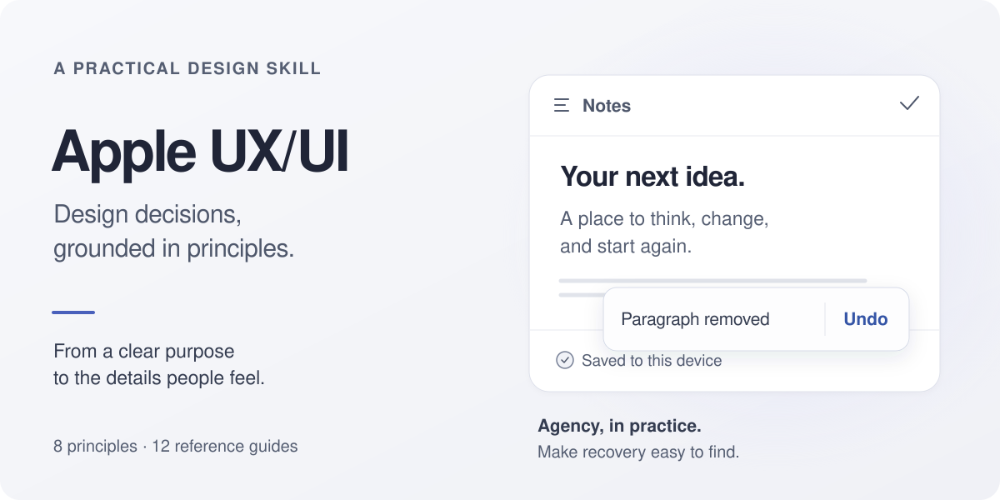

<p align="center">
  
</p>

# Apple UX/UI

Give your coding agent a practical framework for designing and reviewing interfaces: **Apple's eight design principles, twelve reference guides, and source-linked rules for web, desktop, and mobile.**

Use it to decide how a form behaves, whether a dialog is necessary, how people recover from mistakes, and what to check in the rendered result. The skill preserves your product's visual identity and implementation stack.

[Install](#install) · [Try it](#try-it) · [How it works](#how-it-works) · [References](#references) · [Sources](#sources-and-scope)

## Install

With Node.js and npm installed, run the [Skills CLI](https://github.com/vercel-labs/skills) inside your project and choose your agent:

```sh
npx skills add AsianWhiteDude/apple-ux-ui --skill apple-ux-ui
```

Add `--global` to make it available across projects. The CLI supports agents including Claude Code, Codex, and Cursor; discovery and invocation depend on the agent.

<details>
<summary>Manual installation</summary>

Clone the repository, then copy the entire `skills/apple-ux-ui` directory into your agent's skill directory. Keep `SKILL.md`, `references/`, and `scripts/` together.

```sh
git clone https://github.com/AsianWhiteDude/apple-ux-ui.git
```

For an agent without skill discovery, tell it to read `skills/apple-ux-ui/SKILL.md` from the clone and follow the references relevant to your task. The instructions are plain Markdown and do not depend on a particular model or provider.

</details>

No API key, account, Python installation, or network access is needed to read the installed guidance. The optional live-source helper needs Python 3.10+ and internet access.

## Try it

```text
Use the apple-ux-ui skill to review this account settings screen.
Focus on form validation, destructive actions, and preserving unsaved changes.
Keep our existing visual style. Explain the trade-offs and prioritize fixes.
```

Or start with a build:

```text
Use the apple-ux-ui skill to build the first-run flow for this web app.
Let people reach the main task quickly. Check the rendered result at mobile
and desktop sizes, and report what you could not verify.
```

A useful review connects an observed problem to a specific change:

> **Blocker — unsaved edits disappear on navigation.** Preserve a draft, or offer a clear way to save or discard before leaving. Prefer a draft when it avoids repeatedly interrupting the main task. Principle: Agency. Reference: forms and data entry.

This is an illustrative finding, not a benchmark or a claim that every agent will produce the same result.

## How it works

1. **Define the purpose.** Who is the interface for, and what should they accomplish?
2. **Load the relevant guidance.** Read the entrypoint and one to three references for the current task.
3. **Make the trade-off explicit.** Explain which principle takes priority when good goals conflict.
4. **Check the rendered interface.** Report the viewports, appearances, interactions, and limitations actually checked.

The eight principles are **Purpose, Agency, Responsibility, Familiarity, Flexibility, Simplicity, Craft, and Delight**. The full reference library is included in the installation; it is loaded selectively, not injected into every request.

## References

| When you need to… | Read |
| --- | --- |
| Explain a design decision | [Principles](skills/apple-ux-ui/references/principles.md) |
| Review a finished interface | [Review checklist](skills/apple-ux-ui/references/review-checklist.md) |
| Structure a screen or navigation | [Layout and navigation](skills/apple-ux-ui/references/layout-and-navigation.md) |
| Choose a dialog, alert, or notification | [Modality and notifications](skills/apple-ux-ui/references/modality-alerts-notifications.md) |
| Work on type, color, icons, or dark appearance | [Typography and visuals](skills/apple-ux-ui/references/typography-color-visuals.md) |
| Communicate progress and state changes | [Motion, feedback, and loading](skills/apple-ux-ui/references/motion-feedback-loading.md) |
| Write labels, errors, onboarding, or settings | [Writing and onboarding](skills/apple-ux-ui/references/writing-help-onboarding-settings.md) |
| Collect input and preserve people's work | [Forms and data entry](skills/apple-ux-ui/references/forms-and-data-entry.md) |
| Design controls and input interactions | [Actions, menus, and input](skills/apple-ux-ui/references/actions-menus-and-input.md) |
| Address accessibility, inclusion, or privacy | [Accessibility and privacy](skills/apple-ux-ui/references/accessibility-inclusion-privacy.md) |
| Present metrics, tables, or charts | [Data and charts](skills/apple-ux-ui/references/data-and-charts.md) |
| Adapt behavior across platforms | [Platforms and web](skills/apple-ux-ui/references/platforms-and-web.md) |

## Check a live source

From the installed `apple-ux-ui` skill directory:

```sh
python3 scripts/hig.py buttons
python3 scripts/hig.py --list components
```

The helper reads Apple's public documentation and prints Markdown to stdout. It uses Python's standard library, with `curl` as a fallback. It omits images and simplifies some structures; open the original page for visual examples. Fetching a page does not refresh the saved reference library.

## Sources and scope

This is an independent project by [Mikhail Kim](https://github.com/AsianWhiteDude), based on Apple's [Human Interface Guidelines](https://developer.apple.com/design/human-interface-guidelines/) and [Principles of great design](https://developer.apple.com/videos/play/wwdc2026/250/) talk.

The references are a **2026-09-14 snapshot of selected guidance, summarized and adapted for agent workflows**. This repository includes the complete skill library, not the complete Apple HIG or its source corpus. It is not affiliated with or endorsed by Apple.

Rules distinguish Apple sources (`[HIG: slug]`, `[WWDC26-250]`) from this project's adaptations (`[translation]`). See [source and attribution notes](SOURCES.md).

Original contributions are [MIT licensed](LICENSE). Referenced or quoted third-party material remains subject to its owners' rights.

## Development

Run the offline helper tests from the repository root:

```sh
python3 -m unittest discover -s tests -v
```

When contributing a rule, cite its source or mark it as an adaptation. Keep runtime-specific tooling optional, and verify interface changes in a rendered view when available.
